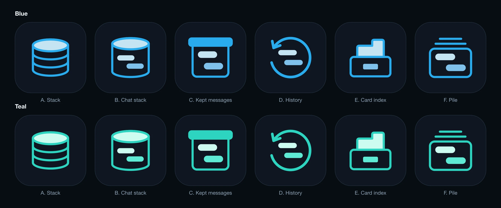
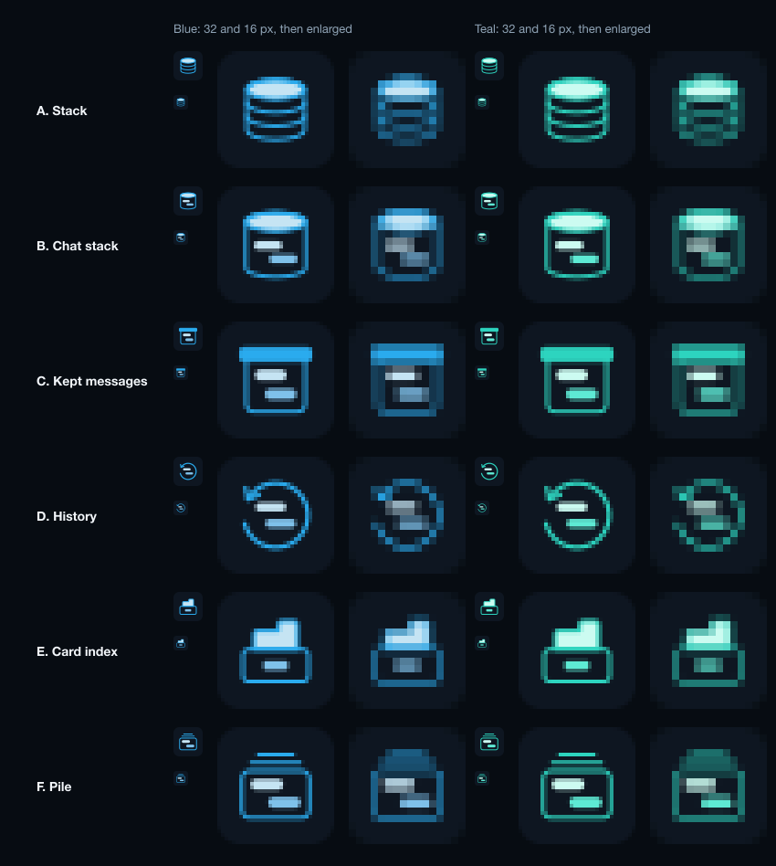
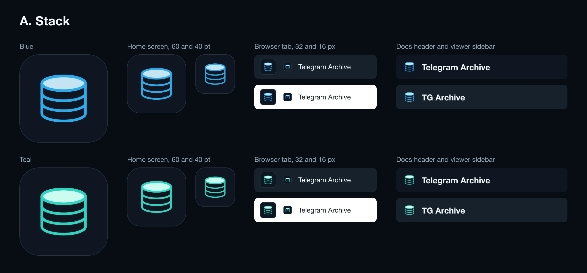
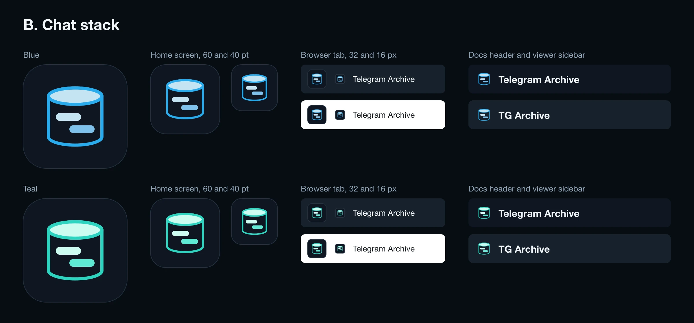
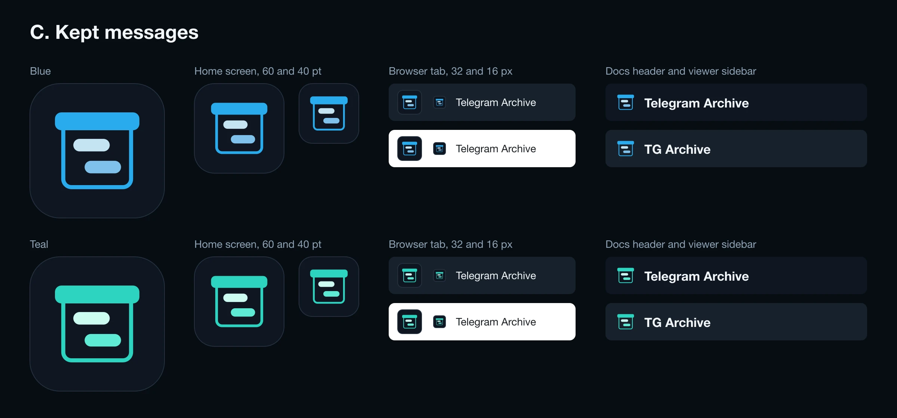
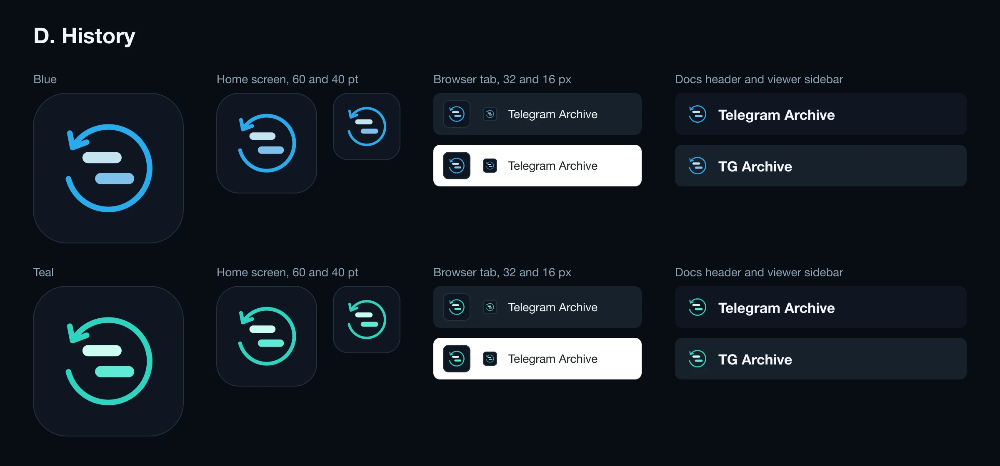
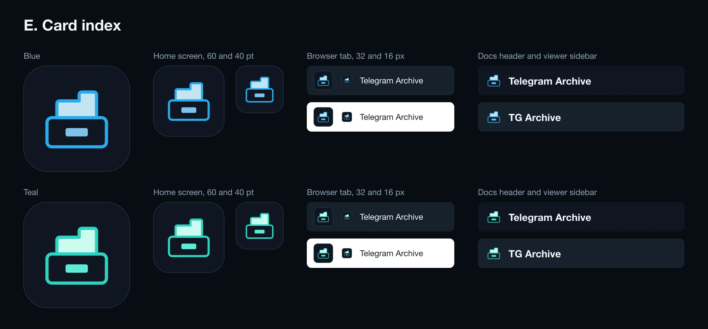

# A new logo: six proposals

> **Implemented.** We ship D, History, in teal. The logo, the favicon, the banner, the social preview, the viewer's installed-app icons and the docs accent now use it, and so does the iOS app. The favicon has its own heavier drawing for 16, 32 and 48 px, `docs/images/favicon.svg`. The pictures below are the proposals as they were compared.

Our mark is a paper plane with a database stack in front of it. The paper plane is Telegram's own mark. App Review rejected TG Archive, the iOS reader, under guideline 4.1(c) for that reason: the icon contains another developer's mark. The same drawing is the docs logo, the favicon, the banner of both repositories and the viewer's installed-app icon.

We need one mark that is ours and that works in all of those places. This page shows six proposals. Nothing ships from this page: we pick one, and a second change replaces the files.



## What every proposal keeps and drops

- **Dropped:** the paper plane, and any shape a reviewer could read as a send arrow or as a chat bubble with a tail.
- **Kept:** the drawing style of the old mark. That is a rounded outline 13 units wide on a 360 grid, flat colours, and at most two filled shapes.
- **Kept:** the dark plate `#0E1621` of the banner and the docs header.
- **New:** five of the six show two message rows, one on the left and one on the right. That is how the viewer lays out a received and a sent message, so the mark says "chats" without a bubble.

## Two colours

Each proposal is drawn in two colourways.

| Colourway | Stroke | Fills | Where it comes from |
| --- | --- | --- | --- |
| Blue | `#2AABEE` | `#C5E4F3`, `#7FC1EA` | The docs accent and the old mark |
| Teal | `#2DD4BF` | `#CCFBF1`, `#5EEAD4` | The accent colour of the iOS app |

`#2AABEE` is Telegram's brand blue. With the plane gone, a reviewer can still read that blue on an app named "TG Archive" as Telegram's look. Teal removes that risk, and the iOS app already uses it for its buttons and links. If we pick teal, the docs accent in `docs/stylesheets/theme.css` and the banner divider change to it as well.

## The proposals

Each sheet shows the mark as the app icon, at two home-screen sizes, in a dark and a light browser tab at 32 and 16 px, and beside the name in the docs header. The sheets are drawn at twice their size, so a 16 px sample there covers 32 pixels.

The next picture is at real size. Each icon is rendered at exactly 32 and 16 pixels, and then shown again with every pixel enlarged to a square. Judge the small sizes from this one.



At 16 pixels the outline is about half a pixel wide in every proposal, so each one is faint in a browser tab. The filled shapes carry the mark at that size: the lid in C, the card in E and the top face in A and B. The mark we pick gets a second drawing with a heavier outline for the 16 and 32 px favicon.

### A. Stack



The database stack of the old mark on its own.

- It keeps the most from the old mark, and it reads at 16 px.
- It is the database symbol that every icon set has. It says "database", not "chats", and on a home screen it looks like a database tool.

### B. Chat stack



The stack as one drum, with two message rows on its front.

- It keeps the stack and adds the chats, so it is no longer a stock symbol.
- At 16 px the rows are two short dashes.

### C. Kept messages



A box with a solid lid, holding two message rows.

- It is the only one that a person who has never seen the project reads as "stored conversations".
- The lid is one solid bar, so the shape holds at 16 px.
- A box with a lid is also the common "archive" symbol. The rows inside and the solid lid are what make it ours.

### D. History



An open ring that runs back, around two message rows.

- It fits the edit history and the jump to a date in the viewer.
- A ring with an arrowhead is the common "undo" and "restore" symbol, and it is close to the Time Machine icon. It carries the highest risk of a second 4.1(c) rejection of the six.

### E. Card index



One index card with its tab, standing in a drawer with a label plate.

- No stock symbol matches its outline.
- It says "files", not "chats", and at 16 px it is a box with a lump on top.

### F. Pile


A chat card with two message rows, on top of a pile of older ones.

- It shows "many chats, kept" and has no box or database in it.
- The two lines above the card are thin at 16 px.

## Recommendation

**C, Kept messages, in teal**, for the app, the favicon, the docs logo and the banners.

- It says both "chats" and "kept", and it reads at every size we use.
- Teal takes the last of Telegram's look out of the icon.

B is the second choice if we want to keep the stack. D should not go to App Review.

## How we checked

Three reviews looked at rendered pictures of each proposal, at 1024, 60, 32 and 16 px:

1. **Marks of other developers.** Does a strict reader of guideline 4.1(c) still see Telegram, another brand, or a system symbol from Apple?
2. **Small sizes.** Does it read at 16 and 32 px, and inside the rounded icon mask?
3. **Fit.** Does it belong beside the viewer and in the docs header, and does it say what the project does?

Three first drafts did not pass and are not on this page: a plain box, which was a near copy of the system "archive" symbol; a letter A, which read as a traffic cone; and a drawer with two cards, which was unreadable at 32 px. The six above include the fixes the reviews asked for.

These reviews are our own reading of the guideline. They do not tell us what App Review decides.

## What changes after we pick

In this repository:

- `docs/images/logo.svg`, `docs/images/icon.svg` and `docs/images/banner.svg`
- `telegram_archive/web/static/favicon.ico`, `apple-touch-icon.png`, `icon-192.png` and `icon-512.png`
- A small-size drawing of the mark with a heavier outline, for the favicon
- `docs/stylesheets/theme.css`, if the accent changes to teal

In TG-Archive-iOS:

- `AppIcon.png`, `docs/images/banner.svg` and `docs/images/social-preview.png`
- The App Store subtitle. The rejection names it too: it holds the name of this project, which contains "Telegram". A subtitle with no brand in it, for example "Read your self-hosted backup", removes that.
- The naming rules in `docs/DESIGN.md` and `AGENTS.md`, which describe the old icon.

## Draw the pictures again

Each proposal is one file, `logo/<key>/mark.svg`. The script puts it on the plate, recolours it, and writes the sheets and the icon files:

```bash
python3 docs/design/rig/logo-sheet.py
```

It needs `rsvg-convert` and ImageMagick.
